<p align="right"><sub><b>English</b> · <a href="README.md">Español</a></sub></p>

# hinokakera-android

<p align="center">
  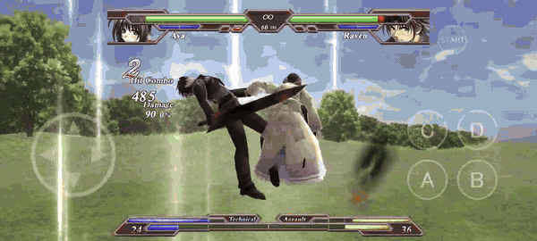
  <br><sub>On a Samsung Galaxy A52 (2400×1080, 20:9): full screen with no borders, touch controls, 60 fps.</sub>
</p>

An Android (and modern Windows) port of **Hinokakera Chaotic Eclipse** v1.01 (Reddish Region, 2010), a 3D fighting
game for Direct3D 9, by **static recompilation**: the original `.exe` is translated instruction by instruction from
x86 to C, and the only things rewritten are the Windows DLLs it uses (kernel32, user32, gdi32, winmm, dsound,
dinput8, ws2_32, d3d9, d3dx9), on top of SDL3 and OpenGL ES 3. The logic, the AI, the combos and the drawing are the
game's own.

> The repo **does not include the game**: not the executable, not its translated code, not its data. You need your
> own copy of Hinokakera Chaotic Eclipse v1.01 to generate everything (see below).

## On the phone

| | |
|---|---|
| 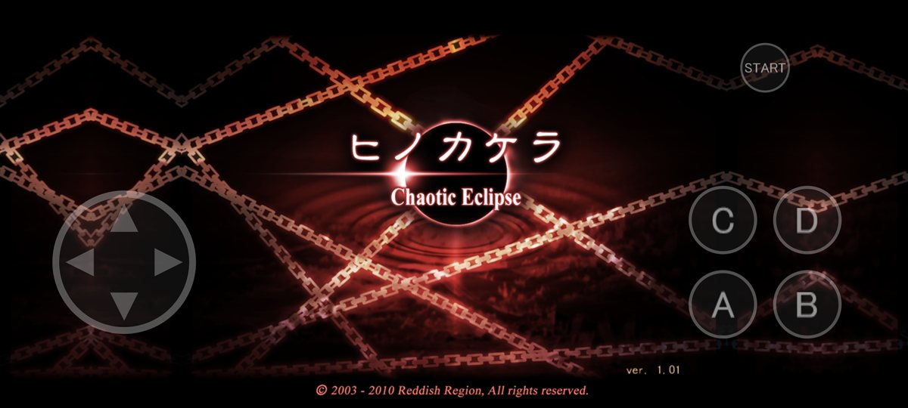 | 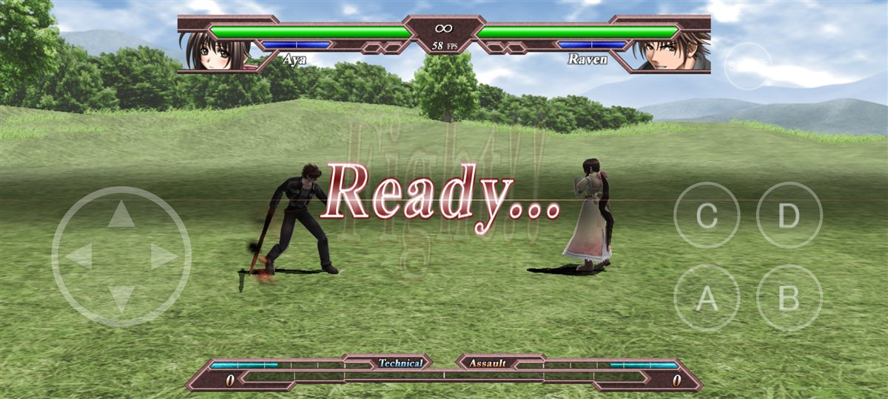 |
| The title, with the touch controls on top | Outskirt Hill at 20:9: the 3D shows more of the stage |
| 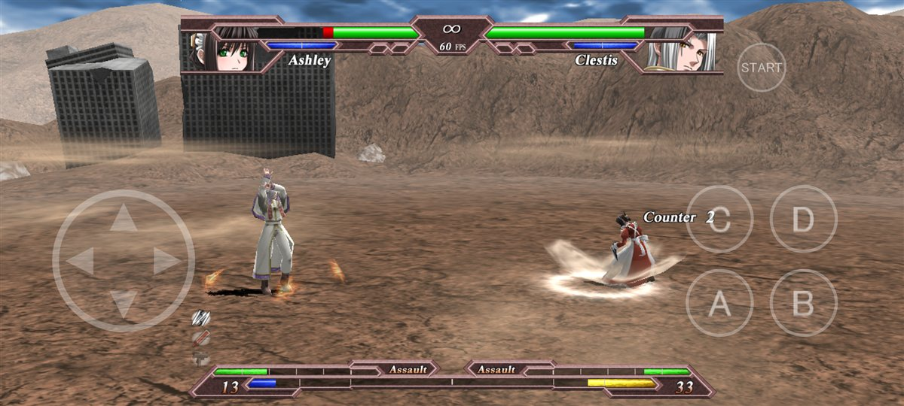 | 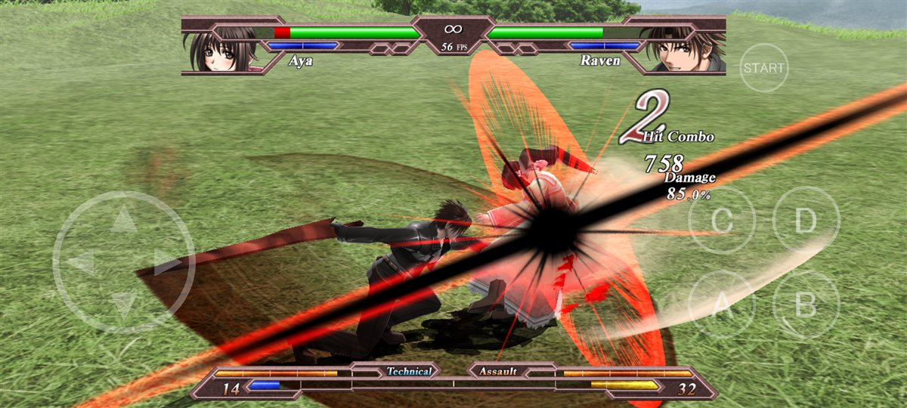 |
| Wasteland | Combos and effects at 56–60 fps (Adreno 618) |
| 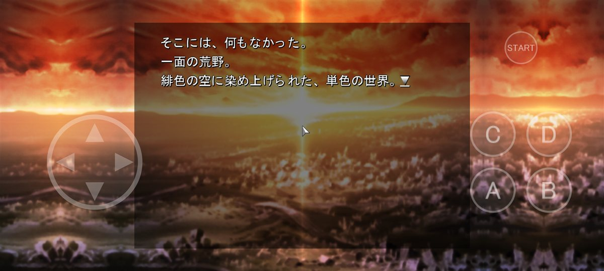 | 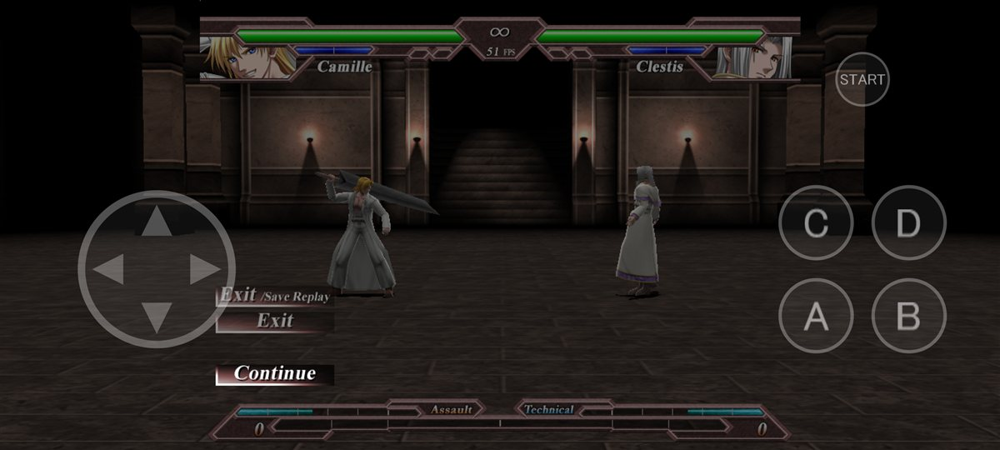 |
| Story mode: the 4:3 background is extended by mirroring, and you tap the screen to advance | The Back button pauses (Law Board) |

## Widescreen, no black bars

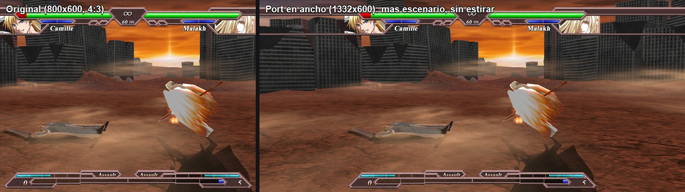

The same fight frame in the original and in the widescreen port: the HUD and the 2D stay at 1:1 in the center and the
3D camera opens up at the sides, with nothing stretched. The 4:3 2D screens are rebuilt to fill the width:

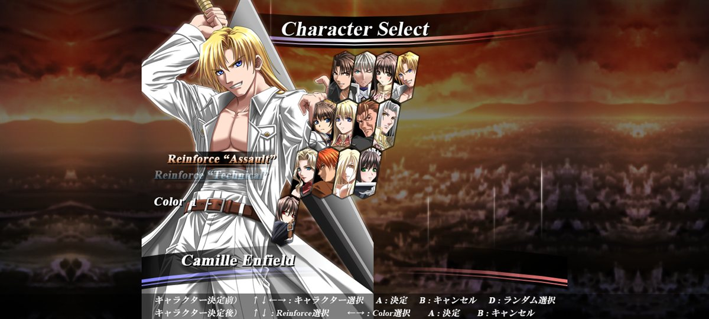

## New stage: Outskirt Hill at night

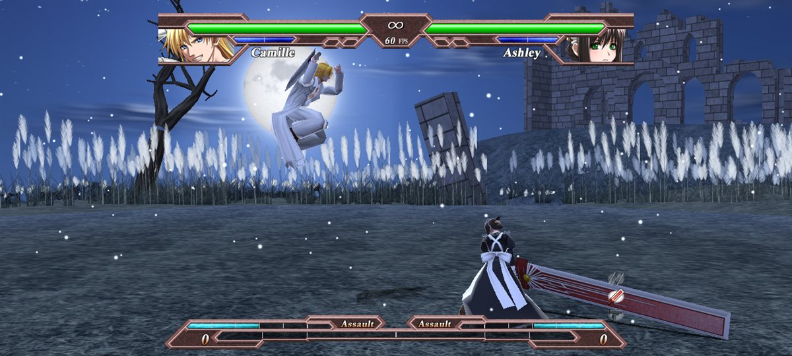

Outskirt Hill remade in the style of Moonlit Wilderness (Tekken 7): a full moon, Gothic ruins on a hill, a dead tree,
a toppled monolith, a field of pampas grass and floating fluff. Everything comes from code in `tools/escenario/`: the
sky, the moon, the pampas grass and the stone are painted procedurally, the ruins and the trees are modeled in 3D, and
the original's grass and hills are turned into night. A new `vsobj2.dat` is built (the game looks in it before the
rest), without touching the executable, and the stage select thumbnail changes too.

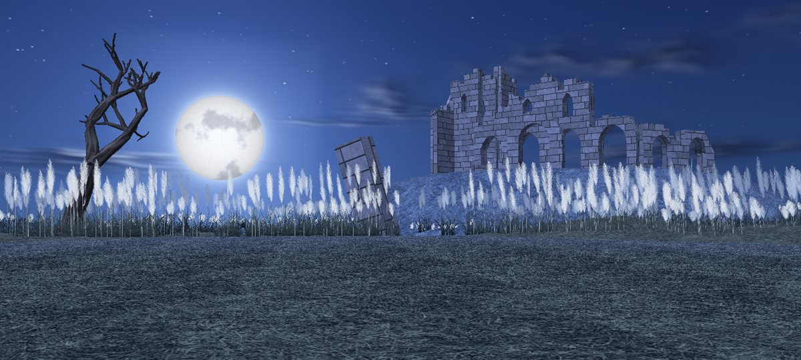

## New stage: Sunlit Shore

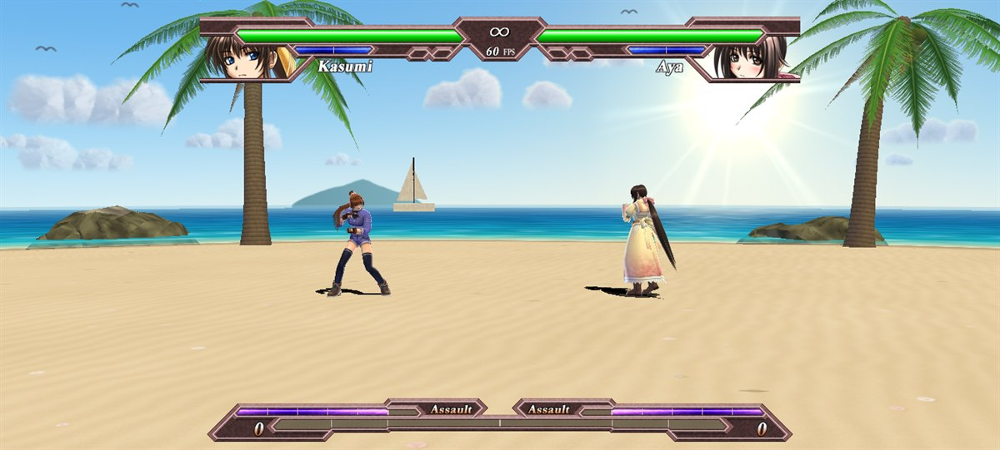

A sunny beach that **joins** the usual seven stages: it's the tenth in `field.dat` and the eighth slot of the select
wheel, before Random. A turquoise sea with foam on the shore, breaking waves and a path of glitter under the sun, palm
trees leaning over the water, rocks, two headlands (one with a lighthouse), a pier with life rings, a beached boat, a
beach umbrella with deck chairs, a thatched beach bar among grassy dunes, a sailboat, islands on the horizon and
cumulus clouds with seagulls. Like Outskirt Hill, everything comes from code (`tools/escenario/playa.mjs`), the name
on the wheel too, which is put together from letters cut out of the other names so it has the same typeface.

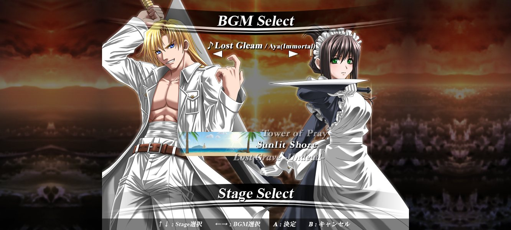

One more stage means changing the game: the wheel had eight fixed slots, 9 was the "random" marker and Random picked
among 7. `analisis/parches.txt` changes 34 instructions and one constant of the exe while translating it (the number
of slots, the slot → stage mapping, random among 8 and the texture coordinates of the wheel, which are now twice as
tall) and adds five C fragments. The rest of the logic, the AI and arcade mode don't change.

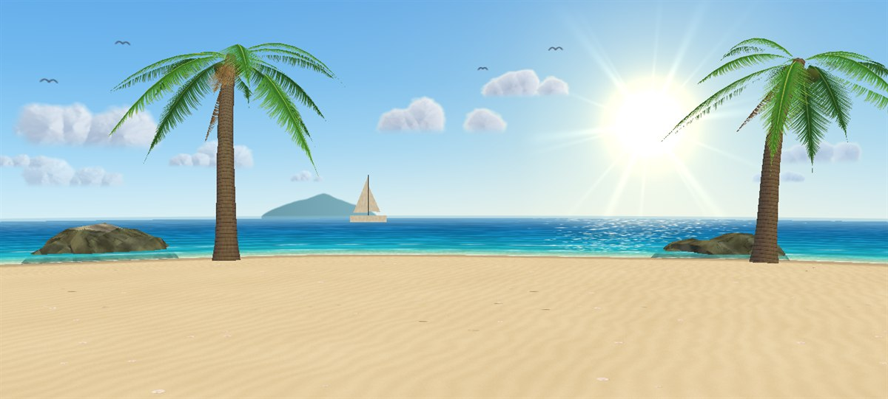

```sh
node tools/escenario/playa.mjs          # _scratch/hino-android/mods/vsobj2.dat with Outskirt Hill at night and Sunlit Shore
node tools/apk.mjs --datos --release    # the APK comes out with both stages
node tools/escenario/ver.mjs 9 vista.png  # look at a stage without running the game (the image above)
npm test                                # tests the stage tools and the patches
```

The translated code with the patches needs that data: without it, the wheel finds neither the new texture nor the new
stage.

## Online play with rooms

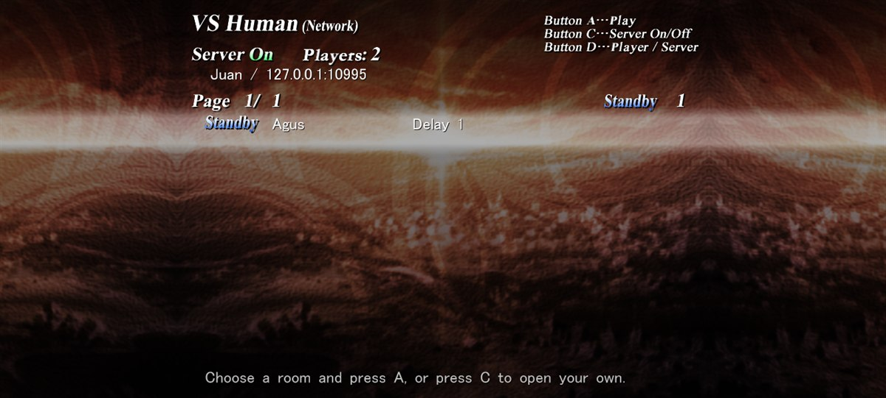

"VS Human (Network)" is now a lobby of rooms, on PC and on Android: each player creates their own (with a name and,
optionally, a password) or joins someone else's, and so plays with whoever they want; many fights can run at once. A
small server (`servidor/salas.mjs`, Node with no dependencies) keeps the rooms and introduces the players; the fight
goes directly between the two, IP to IP, over the game's own UDP protocol. The lobby wears the face of the original
network screen: the same background, the title, "Server On/Off", "Standby"/"Busy", the pulsing bar and the MS Gothic
text with its shadow, in the same places. What the game didn't have ("Create Room", "Password", "Players", "Ping", the
hints at the top) is written with letters cut out of its textures (`tools/sala/letras.mjs`): the bold of the stage and
character names and the one from the configuration menu.

| | |
|---|---|
| 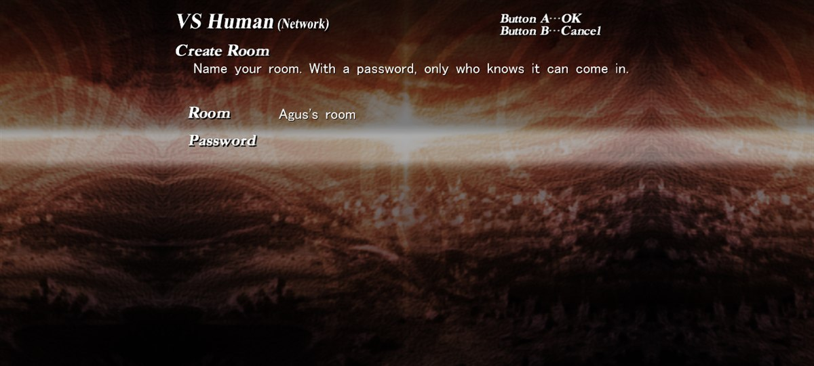 | 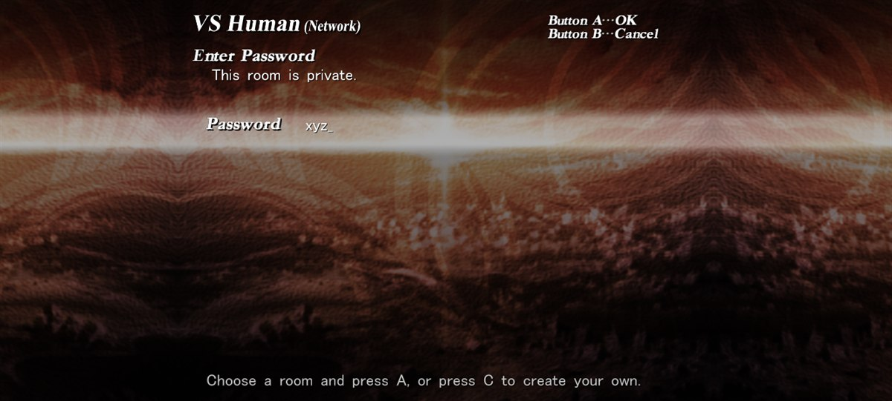 |
| C: create a room, with a name and an optional password | A on a room with a password ("Key"): you type the password |
| 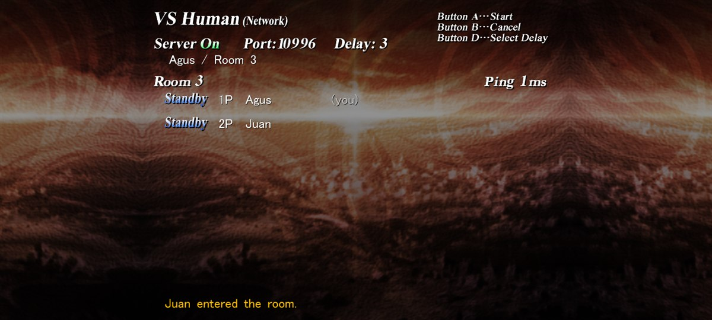 | |
| The room: the host starts (A), kicks the other player (C) or changes the delay (D) | |

```sh
node servidor/salas.mjs     # on a PC or a server with port 10995 (TCP and UDP) open
```

- In the game, "VS Human (Network)". With no server configured, it looks for one on the local network and remembers
  it; otherwise, D lets you type the name and the address (`ip:port` or a domain name).
- C creates a room: a name (by default "<your name>'s room") and a password (empty = anyone can join). The list shows
  each room with its host, how many are in (1/2) and "Key" if it has a password; the ones in Standby are waiting for
  an opponent.
- A joins the selected room (if it has a password, it asks for it). When the two see each other directly (the ping
  shows up), the host presses A and it starts; C kicks whoever joined; D changes the delay (1 to 5, the game's own:
  the host's is the one that counts); B closes the room (or, for the guest, leaves it). Five wrong passwords in a row
  and you can't join private rooms for a minute.
- From there on it's the game's network mode: character select, fight and rematches. When it's over, you're back in
  the lobby.
- Keyboard, gamepad, touch controls or tapping the rows; the buttons are player 1's (or 2's) from `config.dat`.

How it works: the server only knows names and rooms. When a room fills up, it gives each player the other's address:
the public one (the one the server sees in a UDP packet sent from the game's socket) and the one on their local
network. From that same socket the two send each other packets until they meet (NAT hole punching), and from then on
each one answers the other wherever the other's last packet came from, so it also works behind a symmetric NAT on one
side. When the fight starts, the lobby presses the original network mode's keys for the players (Server On, request
the fight, accept it): `net.txt` has a single entry, `127.77.0.1`, which `win32/ws2_32.c` translates into the
opponent's address.

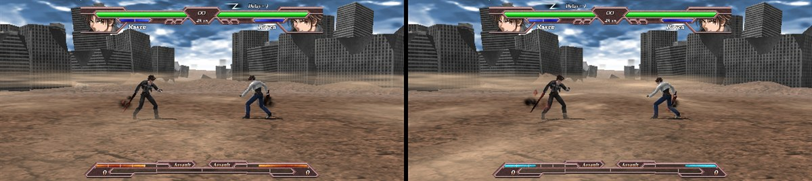

For the original's network mode to work in the port, two things had to be fixed: `WSAGetLastError` was lost when the
guest lock's turn was taken back (the receiving thread died), and the host waits for the confirmation in a loop that
only reads `timeGetTime`, which now yields the turn. Limits: if both players are behind a symmetric NAT (some mobile
networks with CGNAT) there may be no direct path, and there's no relay through the server; the server's port has to
be reachable; each player sees the other's IP, as in any IP-to-IP game.

## How faithful it is

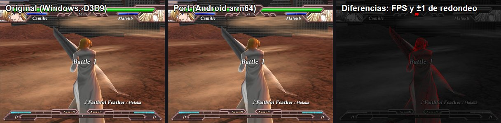

The backbuffer is compared against the one from the original game running on Windows (with a spy `d3d9.dll`,
`tools/c/d3d9_espia.c`) on the same frames and with the same keys (a spy `dinput8.dll`):

| Screen | Android (emulator, arm64 and x86_64) | Windows (port) |
|---|---|---|
| Title and menus | **100 %** identical pixels | 99.978 % (±1 in one text) |
| Character select | — | 95.4 % (max ±2) |
| Fight (frames 700–2000) | 98.4–99.7 % (the FPS counter and ±1 rounding on the characters) | 94–96.5 % |

The fight advances frame by frame exactly like the original on x86 and on ARM (no FMA: `-ffp-contract=off`). On a
real Galaxy A52 it ran almost 8 minutes straight (27,900 frames) without a hitch.

## How it works

- **`recomp/`** — a translator in Node with [iced-x86](https://github.com/icedland/iced): recursive descent, VC6
  jump tables, functions that never return, flags across functions (the CRT's assembly routines), x87 on `double`
  with the 24/53-bit precision Direct3D leaves set, code discovered through pointers in data. 9,306 functions, 424
  thousand instructions, 0 unsupported ones executed. Before translating, it applies `analisis/parches.txt`: bytes of
  the exe that change (the original is checked first) and C inserted before an instruction.
- **`runtime/`** — 4 GB of guest memory, threads with their TEB, indirect dispatch, fault handling. A guest lock keeps
  the game's threads from running at the same time: the game counts on x86 memory ordering, and on real ARM the music
  thread was reading half-written data.
- **`win32/`** — the Windows APIs the game uses: files (the data is read-only; on Android, assets of the APK), windows
  and messages, DirectInput with a mouse buffer, DirectSound with its own mixer, Winsock (real UDP; on top of it, the
  rooms client), MS Gothic glyphs (real GDI on Windows, a pre-generated cache on Android).
- **`d3d/`** — Direct3D 9 on OpenGL ES 3: the fixed-function pipeline generated as GLSL, `vs_1_x` translated, D3DX
  (textures and mipmaps identical to the real dll's).
- **Widescreen with no borders**: the real backbuffer is as wide as the screen at 600 tall (1332×600 on a 20:9 phone)
  and the game is drawn centered: the 2D stays at 1:1 and the 3D shows more of the stage (Hor+); full-width 2D
  backgrounds are extended by mirroring, and the HUD bands by stretching their edge. `HINO_ANCHO=0` turns it off.
- **Touch controls** (`d3d/tactil.c`): an 8-way D-pad, A B C D and Start, laid out by the screen's physical size and
  safe area; tapping the image is the mouse (story mode is a visual novel). The Back button is Pause. With a gamepad
  connected, the on-screen controls hide.

## Building

Requirements: Node 22+, clang (Visual Studio 2022's) for Windows, and for Android the SDK with NDK 28 and CMake 3.31,
JDK 21 and Gradle 8.11 (see `tools/apk.mjs`). SDL3 3.4.18 goes in `terceros/` (`sdl3-vc/SDL3-3.4.18/` from the
`SDL3-devel-3.4.18-VC.zip` package and `sdl3-android/SDL3-3.4.18.aar`).

```sh
npm install
node recomp/traducir.mjs <path>/hinokakera.exe     # generates gen/ (C, imagen.bin) from your copy of the game
node tools/escenario/playa.mjs                     # the new stages and the lobby's letters (the patched code needs them)
node tools/compilar.mjs                            # Windows: build/win/hinokakera.exe
# glyphs for Android: build tools/c/gen_glifos.c and run gen_glifos.exe <hinokakera.exe> gen/glifos.bin
node tools/icono.mjs                               # the APK icon, taken from the exe
node tools/apk.mjs --datos --release               # an APK with the game inside
```

The game folder comes from `HINO_JUEGO` (by default, `../hinokakera/04_.../Game_Chaotic_Eclipse_v101_Unpacked`). The
full log, with how to test on the emulator and how to debug, is in [`docs/ESTADO.en.md`](docs/ESTADO.en.md); the
design decision, in [`docs/PLAN.en.md`](docs/PLAN.en.md). `tools/escenario/` reads and writes the game's models
(`nmd_`) and textures (`BMT_`), to edit stages.

## Useful variables

`HINO_CAPTURAS=30,120` saves those frames · `HINO_TECLAS="300:2c:1,320:2c:0"` a per-frame key script ·
`HINO_LOG_DIBUJOS=cuadros` lists every draw call · `HINO_LOG_ARCHIVOS=1` file opens · `HINO_OCULTA=1` no window ·
`HINO_ANCHO=0|1332` widescreen mode off or forced · `HINO_SALAS=ip:port` and `HINO_NOMBRE` the rooms server and your
name · `HINO_TEXTO="frame:text|..."` what gets typed into the lobby's forms · `HINO_LOG_RED=1` every packet of the
online game.

## License

The code in this repo is MIT. Hinokakera Chaotic Eclipse belongs to Reddish Region; the screenshots in `docs/img/` are
from the game and are only there to show the port.

<!-- i18n source=README.md sha256=59023759e666 -->
