# hinokakera-android

<p align="center">
  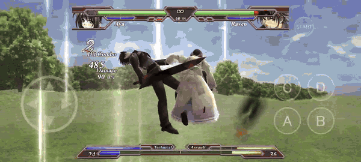
  <br><sub>En un Samsung Galaxy A52 (2400×1080, 20:9): pantalla completa sin bordes, controles táctiles, 60 fps.</sub>
</p>

Port a Android (y a Windows moderno) de **Hinokakera Chaotic Eclipse** v1.01 (Reddish Region, 2010), un juego de
lucha 3D para Direct3D 9, por **recompilación estática**: el `.exe` original se traduce instrucción por instrucción
de x86 a C, y lo único que se reescribe son las DLL de Windows que usa (kernel32, user32, gdi32, winmm, dsound,
dinput8, ws2_32, d3d9, d3dx9) sobre SDL3 y OpenGL ES 3. La lógica, la IA, los combos y el dibujo son los del juego.

> El repo **no incluye el juego**: ni el ejecutable, ni su código traducido, ni sus datos. Hace falta una copia
> propia de Hinokakera Chaotic Eclipse v1.01 para generar todo (ver más abajo).

## En el celu

| | |
|---|---|
| 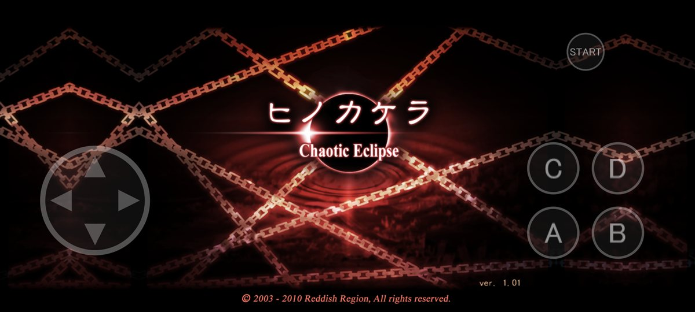 | 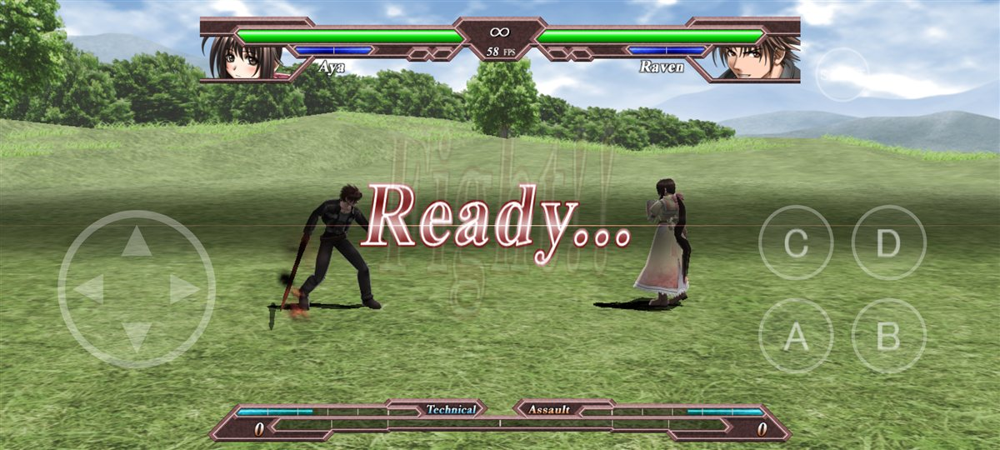 |
| Título, con los controles táctiles encima | Outskirt Hill a 20:9: el 3D muestra más escenario |
| 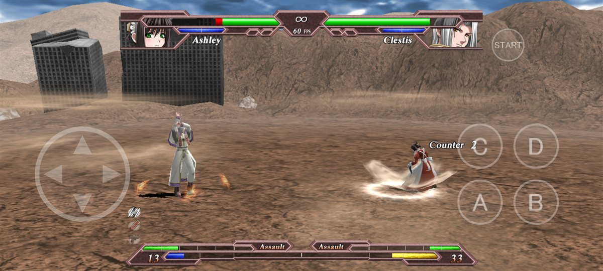 | 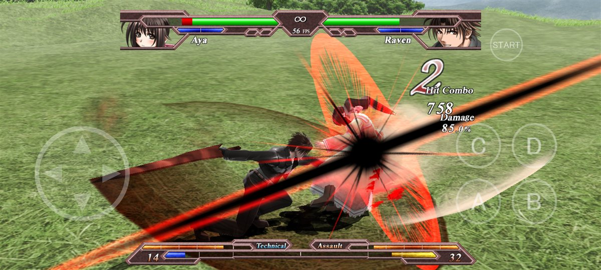 |
| Wasteland | Combos y efectos a 56–60 fps (Adreno 618) |
| 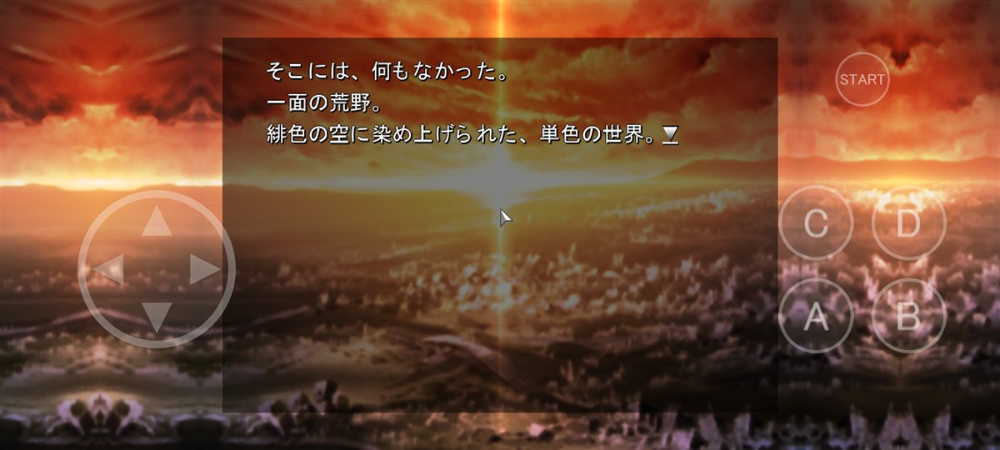 | 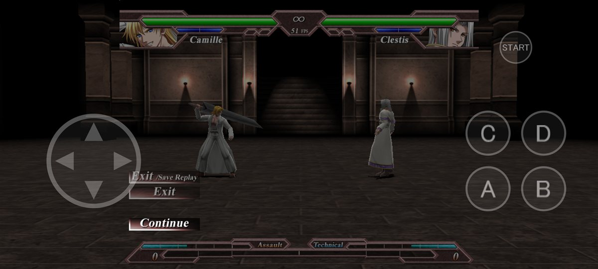 |
| Modo historia: el fondo 4:3 se extiende por reflejo y se toca la pantalla para avanzar | El botón Atrás pausa (Law Board) |

## Pantalla ancha, sin bordes negros

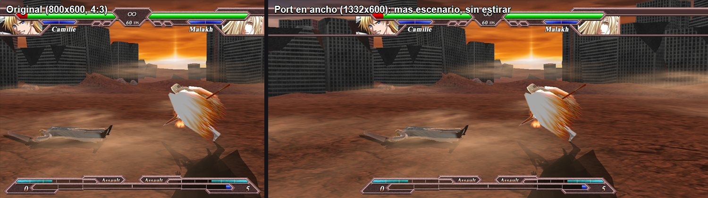

El mismo cuadro de pelea en el original y en el port a lo ancho: el HUD y lo 2D quedan a 1:1 en el centro y la
cámara 3D abre a los costados, sin estirar nada. Las pantallas 2D de 4:3 se rearman para llenar el ancho:

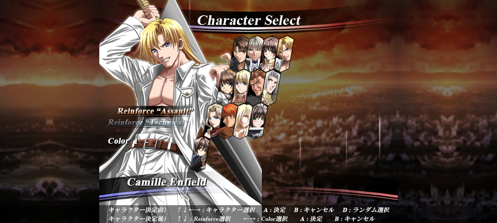

## Escenario nuevo: Outskirt Hill de noche

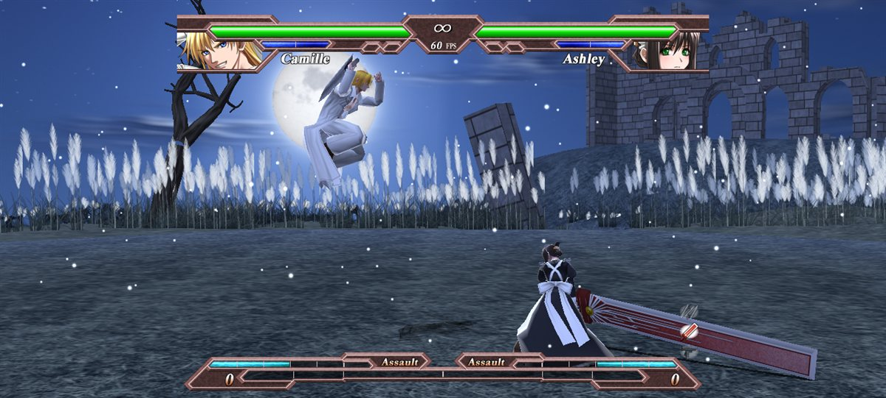

Outskirt Hill rehecho al estilo de Moonlit Wilderness (Tekken 7): luna llena, ruinas góticas en una loma, árbol
seco, monolito vencido, un campo de cortaderas y pelusa flotando. Todo sale de código en `tools/escenario/`: el
cielo, la luna, las cortaderas y la piedra se pintan proceduralmente, las ruinas y los árboles se modelan en 3D, y el
pasto y los montes del original se pasan a noche. Se arma un `vsobj2.dat` nuevo (el juego lo busca antes que el
resto), sin tocar el ejecutable, y también cambia la miniatura de la selección de escenario.

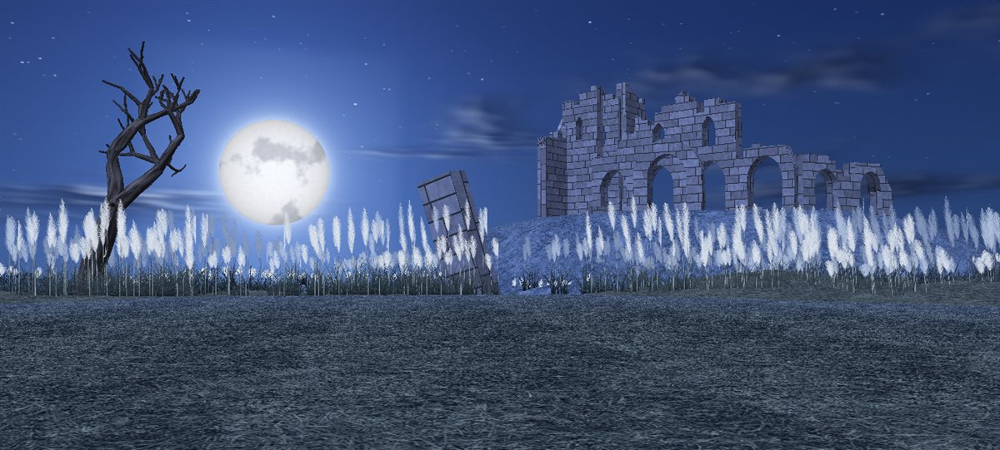

## Escenario nuevo: Sunlit Shore

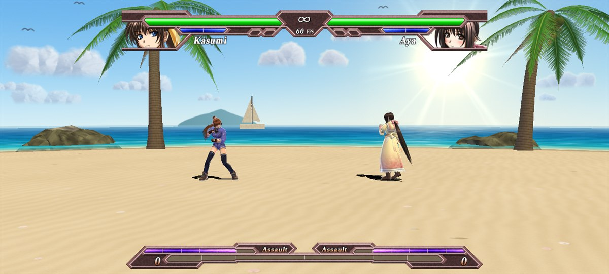

Una playa al sol que **se suma** a los siete escenarios de siempre: es el décimo de `field.dat` y el octavo lugar de
la rueda de selección, antes de Random. Mar turquesa con espuma en la orilla, rompientes y un camino de brillo bajo el
sol, palmeras que se inclinan sobre el agua, rocas, dos promontorios (uno con faro), un muelle con salvavidas, un bote
varado, sombrilla con reposeras, un parador de paja entre médanos con pasto, un velero, islas en el horizonte y
cúmulos con gaviotas. Como Outskirt Hill, todo sale de código (`tools/escenario/playa.mjs`), también el nombre de la
rueda, que se arma recortando letras de los otros nombres para que tenga la misma tipografía.

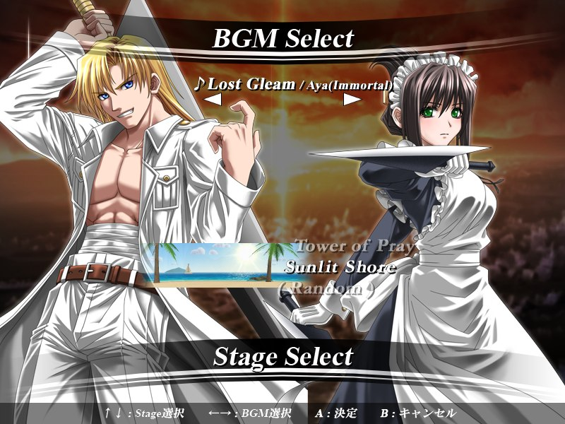

Para tener un escenario más hay que cambiar el juego: la rueda tenía ocho lugares fijos, el 9 era la marca de "al
azar" y Random elegía entre 7. `analisis/parches.txt` cambia 34 instrucciones y una constante del exe al traducirlo
(la cantidad de lugares, el mapeo lugar → escenario, el azar entre 8 y las coordenadas de las texturas de la rueda,
que ahora miden el doble de alto) y agrega cinco fragmentos de C. El resto de la lógica, la IA y el modo arcade no
cambian.

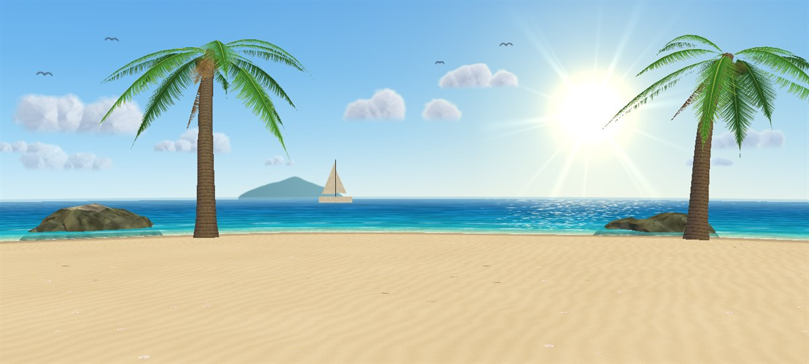

```sh
node tools/escenario/playa.mjs          # _scratch/hino-android/mods/vsobj2.dat con Outskirt Hill de noche y Sunlit Shore
node tools/apk.mjs --datos --release    # el APK sale con los dos escenarios
node tools/escenario/ver.mjs 9 vista.png  # mirar un escenario sin correr el juego (la imagen de arriba)
npm test                                # prueba las herramientas de escenarios y los parches
```

El código traducido con los parches necesita esos datos: sin ellos la rueda no encuentra la textura ni el escenario
nuevos.

## Juego en red con salas

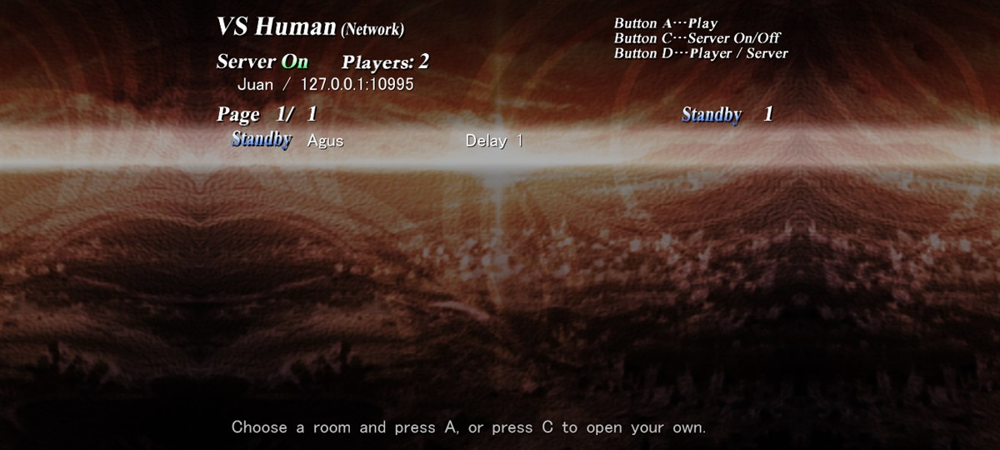

"VS Human (Network)" ahora es un lobby de salas. Un servidor chico (`servidor/salas.mjs`, Node sin dependencias)
mantiene las salas y presenta a los jugadores; la pelea va directo entre los dos, IP a IP, con el protocolo UDP del
propio juego. El lobby tiene la cara de la pantalla de red original: el mismo fondo, el título, "Server On/Off",
"Standby"/"Busy", la barra que late y el texto en MS Gothic con sombra, en los mismos lugares. Lo que el juego no tenía
("Players", "Room", "Ping" y las ayudas de arriba) se escribe con letras recortadas de sus texturas
(`tools/sala/letras.mjs`): la negrita de los nombres de escenarios y personajes y la cursiva fina de sus ayudas.

| | |
|---|---|
| 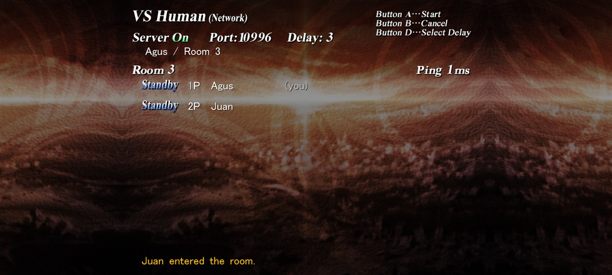 | 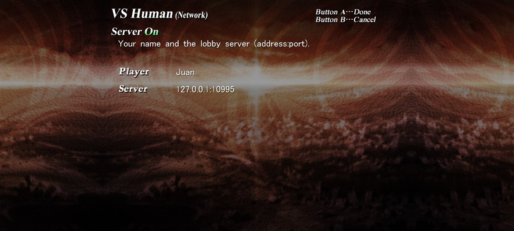 |
| La sala: el anfitrión elige el delay y empieza cuando hay camino directo | D: nombre y servidor (en Android, con el teclado en pantalla) |

```sh
node servidor/salas.mjs     # en una PC o un servidor con el puerto 10995 (TCP y UDP) abierto
```

- En el juego, "VS Human (Network)". Sin servidor configurado lo busca en la red local y lo recuerda; si no, con
  D se escribe el nombre y la dirección (`ip:puerto` o un nombre de dominio).
- C abre una sala; los demás la ven en Standby y entran con A. Cuando los dos se ven directo (aparece el ping), el
  anfitrión aprieta A y empieza; D cambia el delay (1 a 5, el del juego: vale el del anfitrión).
- De ahí sigue el modo red del juego: selección de personaje, pelea y revanchas. Al terminar se vuelve al lobby.
- Teclado, mando, controles táctiles o tocando las filas; los botones son los del jugador 1 (o 2) de `config.dat`.

Cómo funciona: el servidor solo conoce nombres y salas. Cuando una sala se llena, a cada uno le pasa la dirección del
otro: la pública (la que ve el servidor en un UDP que se le manda desde el socket del juego) y la de su red local.
Desde ese mismo socket los dos se mandan paquetes hasta encontrarse (perforación de NAT), y desde ahí cada uno le
contesta al otro por donde llegó lo último suyo, así anda también detrás de un NAT simétrico de un solo lado. Al
empezar, el lobby aprieta por los jugadores las teclas del modo red original (Server On, pedir la pelea, aceptarla):
`net.txt` tiene una sola entrada, `127.77.0.1`, que `win32/ws2_32.c` traduce a la dirección del rival.

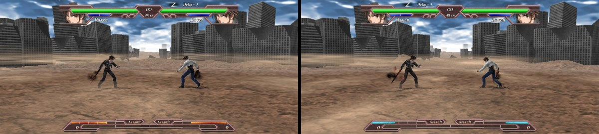

Para que el modo red del original anduviera en el port hubo que arreglar dos cosas: `WSAGetLastError` se perdía al
retomar el turno del candado del invitado (el hilo que recibe se moría) y el anfitrión espera la confirmación en un
bucle que solo lee `timeGetTime`, que ahora cede el turno. Límites: si los dos están detrás de NAT simétrico (algunas
redes móviles con CGNAT) puede no haber camino directo, y no hay relevo por el servidor; el puerto del servidor tiene
que ser alcanzable; cada jugador ve la IP del otro, como en cualquier juego IP a IP.

## Qué tan fiel es

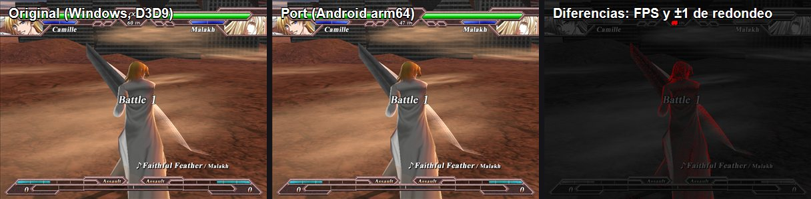

Se compara el backbuffer contra el del juego original corriendo en Windows (con un `d3d9.dll` espía,
`tools/c/d3d9_espia.c`) en los mismos cuadros y con las mismas teclas (`dinput8.dll` espía):

| Pantalla | Android (emulador, arm64 y x86_64) | Windows (port) |
|---|---|---|
| Título y menús | **100 %** de píxeles idénticos | 99,978 % (±1 en un texto) |
| Selección de personaje | — | 95,4 % (máx ±2) |
| Pelea (cuadros 700–2000) | 98,4–99,7 % (el contador de FPS y ±1 de redondeo en los personajes) | 94–96,5 % |

La pelea avanza cuadro por cuadro igual que el original en x86 y en ARM (sin FMA: `-ffp-contract=off`). En un
Galaxy A52 real corrió casi 8 minutos seguidos (27.900 cuadros) sin cortes.

## Cómo funciona

- **`recomp/`** — traductor en Node con [iced-x86](https://github.com/icedland/iced): descenso recursivo,
  tablas de saltos de VC6, funciones sin retorno, banderas entre funciones (rutinas en ensamblador del CRT), x87
  sobre `double` con la precisión de 24/53 bits que deja Direct3D, código descubierto por punteros en datos.
  9.306 funciones, 424 mil instrucciones, 0 sin soporte que se ejecuten. Antes de traducir aplica
  `analisis/parches.txt`: bytes del exe que cambian (se verifica el original) y C que se inserta antes de una
  instrucción.
- **`runtime/`** — 4 GB de memoria del invitado, hilos con su TEB, despacho indirecto, manejo de fallas. Un
  candado del invitado hace que los hilos del juego no corran a la vez: el juego cuenta con el orden de memoria de
  x86, y en ARM real el hilo de la música leía datos a medio escribir.
- **`win32/`** — las APIs de Windows que usa el juego: archivos (los datos son solo lectura; en Android, assets del
  APK), ventanas y mensajes, DirectInput con buffer de mouse, DirectSound con mezclador propio, Winsock (UDP real;
  encima, el cliente de salas), glifos de MS Gothic (GDI real en Windows, caché pregenerada en Android).
- **`d3d/`** — Direct3D 9 sobre OpenGL ES 3: función fija generada como GLSL, `vs_1_x` traducidos, D3DX (texturas
  y mipmaps idénticos a los de la dll real).
- **Pantalla ancha sin bordes**: el backbuffer real mide lo que la pantalla a 600 de alto (1332×600 en un celu
  20:9) y el juego se dibuja centrado: lo 2D queda a 1:1 y lo 3D muestra más escenario (Hor+); los fondos 2D de
  todo el ancho se extienden por reflejo y las bandas del HUD estirando su borde. `HINO_ANCHO=0` lo apaga.
- **Controles táctiles** (`d3d/tactil.c`): cruz de 8 direcciones, A B C D y Start, que se acomodan por tamaño
  físico de la pantalla y zona segura; tocar la imagen es el mouse (el modo historia es una novela visual). El
  botón Atrás es Pausa. Con un mando conectado los controles en pantalla se esconden.

## Compilar

Requisitos: Node 22+, clang (el de Visual Studio 2022) para Windows, y para Android el SDK con NDK 28 y CMake
3.31, JDK 21 y Gradle 8.11 (ver `tools/apk.mjs`). SDL3 3.4.18 va en `terceros/` (`sdl3-vc/SDL3-3.4.18/` del
paquete `SDL3-devel-3.4.18-VC.zip` y `sdl3-android/SDL3-3.4.18.aar`).

```sh
npm install
node recomp/traducir.mjs <ruta>/hinokakera.exe     # genera gen/ (C, imagen.bin) desde tu copia del juego
node tools/escenario/playa.mjs                     # los escenarios nuevos y la letra del lobby (los pide el código parcheado)
node tools/compilar.mjs                            # Windows: build/win/hinokakera.exe
# glifos para Android: compilar tools/c/gen_glifos.c y correr gen_glifos.exe <hinokakera.exe> gen/glifos.bin
node tools/icono.mjs                               # ícono del APK, sacado del exe
node tools/apk.mjs --datos --release               # APK con el juego adentro
```

La carpeta del juego se toma de `HINO_JUEGO` (por defecto, `../hinokakera/04_.../Game_Chaotic_Eclipse_v101_Unpacked`).
La bitácora completa, con cómo probar en el emulador y depurar, está en [`docs/ESTADO.md`](docs/ESTADO.md); la
decisión de diseño, en [`docs/PLAN.md`](docs/PLAN.md). `tools/escenario/` lee y escribe los modelos (`nmd_`) y las
texturas (`BMT_`) del juego, para editar escenarios.

## Variables útiles

`HINO_CAPTURAS=30,120` guarda esos cuadros · `HINO_TECLAS="300:2c:1,320:2c:0"` guion de teclas por cuadro ·
`HINO_LOG_DIBUJOS=cuadros` lista cada llamada de dibujo · `HINO_LOG_ARCHIVOS=1` aperturas de archivos ·
`HINO_OCULTA=1` sin ventana · `HINO_ANCHO=0|1332` modo ancho apagado o forzado · `HINO_SALAS=ip:puerto` y
`HINO_NOMBRE` servidor de salas y nombre · `HINO_LOG_RED=1` cada paquete del juego en red.

## Licencia

El código de este repo es MIT. Hinokakera Chaotic Eclipse pertenece a Reddish Region; las capturas de `docs/img/`
son del juego y están solo para mostrar el port.
